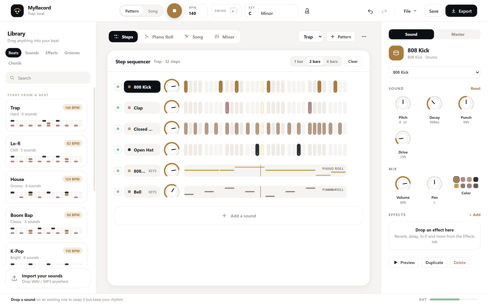

# MyRecord

A free drag-and-drop beat maker for Windows. **Apply, then customize.**

**[⬇ Download for Windows](https://github.com/qub-official/myrecord/releases/latest/download/MyRecord-Setup.exe)** · [Website](https://qub-official.github.io/myrecord/)



> Windows may show "Windows protected your PC" because the installer isn't code-signed yet. Click **More info → Run anyway**.

## Run & build

```
npm install
npm start          # run the app
npm run dist       # build dist/MyRecord-Setup.exe (NSIS installer)
npx electron build/make-icon.js     # regenerate build/icon.png + icon.ico
npx electron build/screenshots.js   # regenerate the website screenshots in docs/assets
```

The landing page lives in [`docs/`](docs/) and is served by GitHub Pages.

## What's inside

| Area | What you can do |
|---|---|
| **Library** (left) | Drag **Beats** (8 genre starters), **Sounds** (28 synthesized drums, bass, keys, synths), **Effects**, **Grooves** and **Chords** into the project. Click `+` or double-click instead of dragging. Drop WAV/MP3 files from Explorer to make your own sounds. |
| **Steps** (F6) | Step sequencer: click/drag to paint, right-click to erase, scroll for velocity. Drop a sound on a row to swap it while keeping the rhythm, or a groove to fill it. |
| **Piano Roll** (F7) | Draw, move and resize notes, set velocity in the lane, highlight a key/scale, drop chord progressions, arpeggiate, build a bassline, humanize. |
| **Song** (F5) | Paint or drag patterns onto 8 tracks, move/resize clips, mute tracks. Switch the top bar to **Song** to play the arrangement. |
| **Mixer** (F9) | Faders, pan, mute/solo, meters, effect chains per sound and on the master. |
| **Inspector** (right) | Shape the selected sound with knobs, swap its instrument, edit its effects. |

Effects: Reverb, Delay (tempo-synced), Filter, Drive, Compressor, EQ, Chorus, Lo-fi (vinyl and wobble), Pump (sidechain-style).

Shortcuts: `Space` play/stop · `Ctrl+Z / Ctrl+Y` undo/redo · `Ctrl+S` save · `Ctrl+O` open · `Ctrl+E` export WAV · `Z–M` / `Q–U` play the selected sound like a piano (`Alt+↑/↓` octave) · double-click a knob to reset.

Projects are saved as `.mrec` files, with imported samples embedded. Your work is also autosaved and restored on the next launch.

## Code map

- `main.js` / `preload.js`: Electron window, file dialogs (save/open/export)
- `src/js/instruments.js`: synthesized instruments (Web Audio)
- `src/js/fx.js`: effects
- `src/js/engine.js`: mixer graph, look-ahead scheduler, offline WAV render
- `src/js/library.js`: templates, grooves, chords, scales
- `src/js/state.js`: project model, undo/redo, actions
- `src/js/widgets.js`, `views.js`, `app.js`: UI
